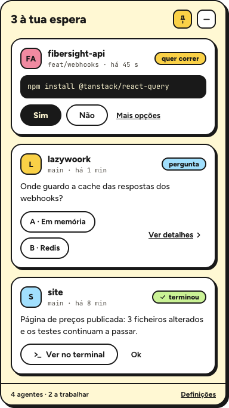
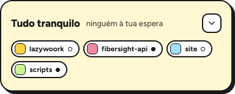
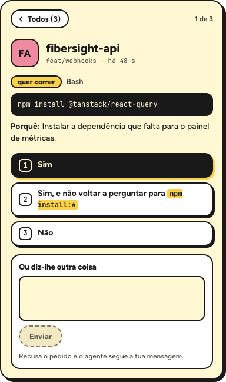
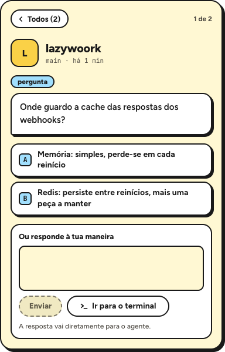
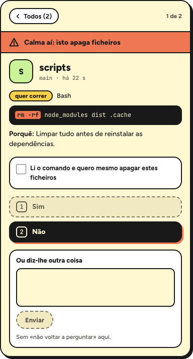

<div align="center">


# Agent Inbox

**An inbox for your agents.** A small floating window, always on top, with one card per Claude Code session that is waiting on you — permissions, questions and finished work. You answer right there, instead of hunting for the right terminal tab.

`macOS` · `Windows + WSL` · Electron + React · everything local



</div>

> The app's interface is in European Portuguese, as are the docs under [`docs/`](docs/). This README is the English guide to it.

---

## The problem

With three to five Claude Code sessions running in parallel, the agents spend half their time idle: one wants to run a command, another asked a question, another finished five minutes ago and nobody noticed. The information is all there — in a terminal tab you are not looking at.

Agent Inbox puts those requests in one place.

## What it does

- **One card per request.** Permissions, questions and "done", from every session, with the agent's name, its branch and how long it has been waiting.
- **You answer in the app.** The buttons are that request's real options — never a fixed list. Or you type a message and the agent follows it instead.
- **Jump to the terminal.** One click brings the terminal window to the front, on the right tab, highlighted.
- **It never gets in the way.** It doesn't steal keyboard focus, and with the app closed Claude Code behaves exactly as it does today.

## The screens

<table>
<tr>
<td align="center" width="33%">
<br />
<b>All quiet</b><br />
Compact mode: one pill per connected agent, filled dot = working.
</td>
<td align="center" width="33%">
<br />
<b>Permission</b><br />
The full command, the reason, and one button per option the request offers.
</td>
<td align="center" width="33%">
<br />
<b>Question</b><br />
A/B options when the request has them; otherwise just the reply box, typed into the right session.
</td>
</tr>
</table>

### Destructive commands

<div align="center">

</div>

Patterns such as `rm -rf`, `git reset --hard` or `DROP TABLE` are highlighted inside the command, "Yes" stays disabled until you tick the confirmation, "No" is the prominent option — and there is **never** a "don't ask again".

## How it works

Claude Code's hooks `curl` into the app over localhost. Nothing leaves the machine.

```
Claude Code (session N)           Agent Inbox (Electron)
  hooks (curl) ──── POST ───────► 127.0.0.1:41823/hook
               ◄─── decision ───  card answered in the app
```

On `PermissionRequest` the app holds the connection open until there is an answer — in the app or in the terminal, whichever comes first. Answer in the terminal and the card disappears on its own. With the app closed, `curl` fails, `|| true` swallows it, and the usual prompt shows up in the terminal as always.

Details in [`docs/architecture.md`](docs/architecture.md) (Portuguese).

## Install (macOS)

```bash
npm install
node node_modules/electron/install.js   # first time only: downloads the Electron binary
npm run dist:mac                        # builds release/Agent Inbox-<version>-arm64.dmg
```

Open the `.dmg`, drag the app into Applications, then register the hooks wherever Claude Code runs:

```bash
node scripts/install-hooks.mjs          # shows what would change
node scripts/install-hooks.mjs --apply  # writes ~/.claude/settings.json (with a backup)
```

The first time you hit "go to the terminal", macOS asks for Automation permission for iTerm2 (Settings → Privacy & Security → Automation).

The app is not signed with a developer account: on first launch use right-click → Open.

### Windows + WSL

The app and WezTerm run on Windows, Claude Code and the hooks run in WSL. Instructions in [`CLAUDE.md`](CLAUDE.md).

## Development

```bash
npm run dev          # app with hot reload
npm run typecheck
npm run screenshots  # rebuilds the images in docs/screenshots
```

## Terminals

| Terminal | Status |
|---|---|
| WezTerm (`wezterm cli`) | full support: focus, highlight the tab, type into the session |
| iTerm2 (AppleScript) | full support |
| Others | reduced mode: cards and permission answers work; no jumping to the tab |

## Principles

1. **Never block.** App closed, erroring or not answered in time → the hook exits and Claude Code carries on as today.
2. **Everything local.** Hooks ↔ app talk over HTTP on localhost only.
3. **Never steal keyboard focus.** A new card draws attention without moving you.
4. **Dynamic options.** The buttons come from each request's real options.
5. **Destructive commands** need an explicit confirmation and never offer "don't ask again".
6. **No duplicates.** One card per request; answering in the terminal clears it; ending a session clears its cards.

## Docs

All in European Portuguese.

| File | What's in it |
|---|---|
| [`docs/product.md`](docs/product.md) | Idea, screens, behaviour rules, acceptance criteria |
| [`docs/design.md`](docs/design.md) | The "Limão" style: tokens, components, tone |
| [`docs/architecture.md`](docs/architecture.md) | Hooks, lifecycle of a request, terminal adapters |
| [`docs/technical-notes.md`](docs/technical-notes.md) | Technical assumptions and their status |
| [`docs/roadmap.md`](docs/roadmap.md) | Plan and phases |

## License

[Apache 2.0](LICENSE).
